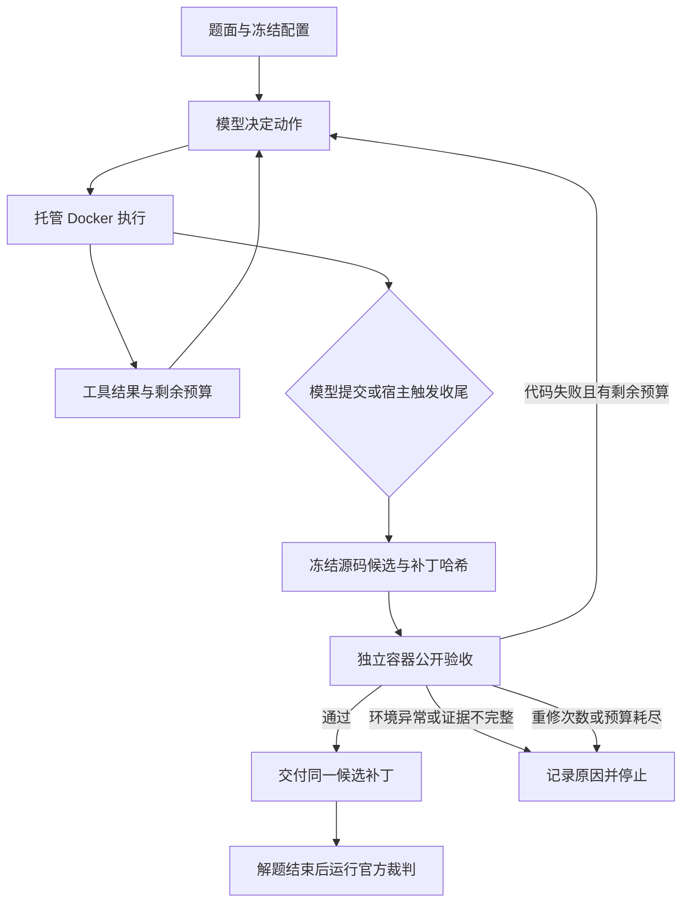

# Mini-SWE Harness

**面向代码修复 Agent 的预算感知执行与可验证补丁交付。**

Mini-SWE Harness 基于 [mini-swe-agent](https://github.com/SWE-agent/mini-swe-agent)，
聚焦 Coding Agent 从“持续探索”走向“完成交付”的工程问题：
在有限调用预算内推动收尾，将真实源码改动冻结成候选，在独立容器中验收，
并把失败反馈、请求恢复和过程记录接回同一条执行链。

保留上游简洁的单 Agent 循环与模型适配层，通过可选的 Agent 子类和 Harness 组件扩展，
不引入多 Agent 调度平台，不替换上游 `DefaultAgent`。

### 结果速览

在 **10 道 SWE-bench Verified 固定回归任务**上，对比本项目的提交验证版（B3）
与预算收尾版（B4），保持相同模型配置和每题 60 次请求预算：

| 问题解决率 | 非空补丁交付率 | 预算耗尽空交付 | 模型请求数 |
|---|---|---|---|
| **60% → 90%**（6/10 → 9/10） | **60% → 100%**（6/10 → 10/10） | **4 → 0** | **467 → 436**（−6.64%） |

这组结果对应“预算反馈＋提醒＋主动收尾”的组合改进。对照定义、逐题结果与适用范围见下文评测章节。

[运行与评测](docs/harness/运行与评测.md) ·
[实验报告](docs/harness/evaluation-20261009/README.md) ·
[本地验证](docs/harness/publication-validation.md) ·
[来源与贡献](docs/harness/贡献边界.md)

## 为什么做这个项目

模型能够查代码、执行命令和生成补丁，并不意味着任务会自然收敛到一次有效交付。
我们在修复轨迹中遇到的关键问题是：探索占满预算、请求故障打断任务、
测试输出难以判断，以及“验证过的代码”和“最终交付的补丁”缺少明确绑定。

本项目把这些问题拆成宿主程序可以检查、记录和测试的机制，而不只依赖模型遵循提示。

| 遇到的问题 | 本项目的机制 | 代码入口 |
|---|---|---|
| 持续探索、预算耗尽仍未提交 | 返回剩余预算；75% 提醒，90% 或时间预留触发宿主验证，不额外赠送模型调用 | [wrapup.py](src/minisweagent/agents/wrapup.py) |
| 验证版本与交付补丁不一致 | 从真实文件树捕获新增／修改／删除，哈希绑定候选，独立容器验收后交付同一补丁 | [snapshot.py](src/minisweagent/harness/snapshot.py)、[validation.py](src/minisweagent/harness/validation.py) |
| 失败后无边界重试 | 代码失败回传，原预算内最多重修两轮；同一失败候选复用验证 | [verified.py](src/minisweagent/agents/verified.py) |
| API 瞬时故障打断任务 | 最多补试两次、等待 4／8 秒，失败请求计入预算，不重放工具或重置时钟 | [recovering.py](src/minisweagent/agents/recovering.py) |
| 管道退出码掩盖 pytest 失败 | 可选 `mini-test` 直接运行 pytest，返回真实退出码、计数、限长失败摘要与完整日志路径 | [test_feedback.py](src/minisweagent/harness/test_feedback.py) |
| 超时后遗留子进程 | 容器内进程组清理；提交中断后补齐未执行工具反馈 | [managed_docker.py](src/minisweagent/environments/managed_docker.py)、[supervisor.py](src/minisweagent/harness/supervisor.py) |

## 架构：执行、验收与判分分离



这三个环节回答不同的问题：

- **执行层**：模型下一步做什么？命令是否完成？还剩多少预算？
- **验收层**：当前候选是否满足预先冻结的公开回归合同？验收版本是否与交付版本一致？
- **评测层**：交付补丁是否通过 SWE-bench 官方问题测试？隐藏裁判材料不回传解题模型。

### 1. 预算感知与主动收尾

`WrapupAgent` 综合调用次数、已知费用及未知费用风险预留、墙钟时间，计算预算消耗比例。
每轮向模型回传预算信息，在达到 75% 时提醒收敛，在达到 90% 或必须预留验收时间时，
由宿主主动捕获当前源码候选并尝试验收。

这不要求模型先主动说“我完成了”，也不额外赠送调用次数。候选通过验收才交付；
没有源码修改、验收失败或时间不足时，保留明确的终止原因。
代码失败仍可在原预算内修复，最多启动两轮重修。

### 2. 绑定候选、验收结果与交付补丁

`Snapshotter` 从任务容器实际文件树中捕获修改、新增与删除，不直接相信模型打印的 diff。
候选同时记录源码树哈希、补丁哈希与初始状态；受保护测试／配置、越界路径、
符号链接及不支持的二进制改动会被拒绝。

`PublicValidator` 在独立容器中恢复初始状态、应用补丁，并在测试前后检查候选一致性。
验收缓存按候选树、补丁、公开合同、环境配置和报告器版本共同生成标识；
同一失败候选可以复用结果，连续无进展提交会停止，避免重复验证消耗预算。

### 3. 不只检查退出码的公开验收

每道任务有一份 `PublicContract`，冻结镜像、初始树、测试命令、预期测试 ID、
允许的 skip/xfail、受保护文件与超时。

验收同时核对测试收集集合、setup/call/teardown 报告、JUnit 用例数量和进程退出码。
漏收集测试、意外跳过、零实际通过测试、报告缺失、候选变化和清理失败，都不能被视为验收成功。
**公开回归负责检查既定测试合同，官方裁判负责判断目标问题是否解决。**

### 4. 有界请求恢复与进程治理

`RequestRecoveryMixin` 针对连接、超时及部分服务端瞬时错误进行最多两次补试，等待 4／8 秒。
关闭模型适配层和 SDK 的内部重试，使一次物理请求能够单独计数；
失败请求计入预算，usage 缺失时保留“费用未知”状态及风险预留。

恢复只作用于模型请求，不重放已执行工具、不清空上下文、不重置任务时钟。
容器内命令由进程组监督器管理；超时清理相关进程，批量工具调用被中断时，
为未执行动作补齐明确反馈，避免对话记录留下悬空的工具调用。

### 5. 结构化测试反馈与事件记录

可选 `mini-test` 在托管环境中直接执行 pytest，输出真实退出码、通过／失败／错误／跳过计数、
最多三项失败详情、限长日志尾部和完整日志位置。
它针对 `pytest ... | tail` 一类场景中退出码被过滤命令掩盖的问题，为模型提供更清晰的观察。

`mini-test` 是显式开启的工具入口，不是全局系统命令，也不替代独立验收；普通 Shell 行为保持不变。
运行过程以 JSONL 事件记录请求、工具执行、候选冻结、验收、重修、预算提醒和终止原因，
便于从“失败了”进一步定位到“在哪个环节、因为什么失败”。

## 评测结果

### 实验设计

2026-10-09，在 10 道 SWE-bench Verified 固定回归任务上进行配对对照，
覆盖 Requests、pytest、Sphinx 三个仓库，每题每组各一次。

| 控制项 | 配置 |
|---|---|
| 模型 | `deepseek/deepseek-flash`，thinking enabled、reasoning effort `max` |
| 每题预算 | 60 次物理请求、1800 秒、2 美元费用软阈值 |
| 执行条件 | 相同任务镜像、题面、公开合同；容器 2 CPU / 4 GiB |
| B3：提交验证版 | 独立提交验收、最多两轮重修、有界请求恢复 |
| B4：预算收尾版 | B3 ＋预算反馈、75% 提醒、90%／时间预留主动验收 |
| 裁判检查 | 推理前运行 empty/gold 控制，解题结束后独立判分 |

### 结果对比

| 指标 | 提交验证版 B3 | 预算收尾版 B4 | 变化 |
|---|---:|---:|---:|
| 官方判定问题解决 | 6/10（60%） | **9/10（90%）** | **+30 个百分点** |
| 非空补丁交付 | 6/10（60%） | **10/10（100%）** | **+40 个百分点** |
| 预算耗尽空交付 | 4 | **0** | 减少 4 次 |
| 模型物理请求总数 | 467 | **436** | **−6.64%** |
| 解题阶段耗时 | 77.73 分钟 | 76.83 分钟 | 基本持平 |
| 公开验收接受但官方未解决 | 0 | 1 | 暴露问题级覆盖缺口 |

本轮观察到的收益是：**在相同调用上限下减少空交付，获得更多最终通过官方测试的补丁。**
三个任务从未交付变为解决，另一个任务获得了非空补丁但仍未解决。
两次宿主主动交付中一题成功、一题失败，因此把增益归于整套收尾策略，而不是单一触发动作。

### 一个值得继续改进的案例

`sphinx-8056` 的候选通过公开回归，官方原有行为测试（PASS_TO_PASS）40/40，
但目标问题测试（FAIL_TO_PASS）0/1。这说明交付与回归验收已完成，目标缺陷仍未修复。
下一阶段重点是增加“修复前失败、修复后通过”的问题级最小复现，而不是把回归通过当作终点。

### 评测口径与证据

以上是本项目两个迭代版本在固定 10 题上的结果；B3 是增强后的提交验证版，
不是未经修改的上游原版。样本已参与诊断，每题单次、固定 B3→B4 顺序，
结果用于评估当前机制，不外推为全量 SWE-bench 成绩或统计显著收益。
`mini-test` 为后续新增，未参与本轮对照。

公开材料包括 [实验报告](docs/harness/evaluation-20261009/README.md)、
[20 次尝试汇总](docs/harness/evaluation-20261009/summary.json)、
[审计汇总](docs/harness/evaluation-20261009/audit-summary.json) 与 10 份公开测试合同。
可用下方脚本离线复算指标。完整原始轨迹和运行目录保留在本地，公开摘要不等于完整原始证据包。

```bash
python examples/inspect_results.py
```

## 快速开始

所有命令在仓库根目录执行。公开版在 Python 3.12 验证；普通机制测试不需要 Key，
Docker 集成测试和真实任务需要能运行 `linux/amd64` 镜像的 Docker。
Apple Silicon 需要另外检查模拟器稳定性，本项目不自动配置虚拟机。

### 安装

公开版代码推送后，可执行；推送前请在已准备的本地公开版目录安装：

```bash
git clone https://github.com/15036970346/mini-swe-harness.git
cd mini-swe-harness
python3 -m venv .venv
source .venv/bin/activate
python -m pip install -c constraints-harness.txt -e '.[harness-dev]'
```

发行包名为 `mini-swe-harness`，导入包仍为 `minisweagent`，保留上游 `mini` 命令和导入版本字段。
请使用独立虚拟环境，不与另一个 `mini-swe-agent` 安装混用。本项目尚未发布 PyPI，须从源码安装。
`constraints-harness.txt` 固定本次公开版验证依赖，不是历史模型实验的依赖锁。

### 不调用模型，先检查结果与机制

```bash
# 标准库即可运行：复算历史摘要，不是重跑 Agent。
python examples/inspect_results.py

# 下载固定数据并校验摘要，不刷新任务或镜像；运行数据被 Git 忽略。
python study/evaluation/prepare.py --restore-runtime

PYTHON_DOTENV_DISABLED=1 MSWEA_SILENT_STARTUP=1 \
LITELLM_LOCAL_MODEL_COST_MAP=True MINI_LIVE_RECOVERY_TEST=0 \
MINI_HARNESS_DOCKER_TESTS=0 \
python -m pytest -q tests/harness study/evaluation/test_comparison.py tests/publication
```

普通测试跳过真实 Docker 和付费模型场景，不能把跳过当通过。
公开版新环境普通检查 **42 通过、27 跳过**；沿用原验证依赖的完整 Harness 集
**62 通过、2 跳过**，另在新环境通过 3 项 Docker 冒烟检查。这些不是全仓库或模型性能成绩。
验证范围和环境区别见 [发布前验证](docs/harness/publication-validation.md)。

### 如何运行增强版

推荐先运行确定性演示，再进行单题真实模型对照。这样可以先验证机制和环境，再支付模型费用。

| 入口 | 用途 | 模型费用 |
|---|---|---|
| `examples/inspect_results.py` | 复算已公开的历史汇总 | 无 |
| `tests/harness/test_wrapup.py` | 用同一预设动作序列演示预算耗尽与主动收尾的差异 | 无，需要 Docker |
| `study/evaluation/compare.py` | 冻结配置 → 裁判预检 → Agent 执行 → 官方判分 → 汇总 | `run` 阶段有 |
| `mini` | 上游交互命令，体验默认 Agent | 取决于模型配置 |

准备好 Docker、任务镜像及内部网络后，可运行无模型费用的收尾演示：

```bash
PYTHON_DOTENV_DISABLED=1 MSWEA_SILENT_STARTUP=1 \
LITELLM_LOCAL_MODEL_COST_MAP=True MINI_LIVE_RECOVERY_TEST=0 \
MINI_HARNESS_DOCKER_TESTS=1 \
python -m pytest -v tests/harness/test_wrapup.py -k same_wandering_script
```

单题真实评测按以下顺序进行；先完成 [运行与评测指南](docs/harness/运行与评测.md)
中的 Docker 和独立裁判配置，并按下一节为宿主设置 API Key：

```bash
# 新建实验，冻结源码、配置、题面和公开合同；输出目录必须尚不存在。
python study/evaluation/compare.py freeze study/artifacts/my-b3-b4 \
  --wrapup --request-recovery \
  --contract study/evaluation/public-validation-pilot-v1.json

# 不调用模型：空补丁应失败，标准补丁应通过。
python study/evaluation/compare.py preflight study/artifacts/my-b3-b4

# 从这里开始产生 API 费用：同一道任务运行两个版本。
python study/evaluation/compare.py run study/artifacts/my-b3-b4 \
  --variant B3 --variant B4 --limit 1
python study/evaluation/compare.py report study/artifacts/my-b3-b4
```

完整 10 题复跑和 `--test-feedback` 开关见运行指南。
直接运行 `mini` 是上游交互入口；本项目增强机制需要由 `compare.py` 显式启用。

### API Key 配置

只在宿主进程设置 `DEEPSEEK_API_KEY`，不写入 Python、YAML、README 或 Shell 命令历史。
已激活虚拟环境后，可通过下面的隐藏输入打开临时子 Shell，在其中运行付费命令，结束后 `exit`：

```bash
python - <<'PY'
import getpass
import os
import subprocess
key = getpass.getpass("DeepSeek API Key（输入不显示）: ")
subprocess.run([os.environ.get("SHELL", "/bin/sh")],
               env=os.environ | {"DEEPSEEK_API_KEY": key}, check=True)
PY
```

模型配置在 [pilot.yaml](study/evaluation/pilot.yaml)，是历史实验配置；提供方别名及可用性可能变化。
换模型或参数必须另建实验，不覆盖旧结果。

## 运行产物与故障定位

每次实验写入独立目录，已有实验不会被静默覆盖。典型结构为：

```text
study/artifacts/<实验名>/
  run-manifest.json           任务、变体及冻结文件摘要
  frozen/                    本轮源码、题面、公开合同与依赖记录
  controls/                  empty/gold 裁判控制结果
  attempts/<任务>/<变体>/
    agent/
      trajectory.json        模型与工具交互记录
      events.jsonl           请求、验收、重修、收尾与终止事件
      candidates/            候选快照与补丁
      validations/           独立公开验收报告
      tool-tests/            可选 mini-test 的完整日志
      result.json            终止原因、预算与交付信息
    judge/                   官方裁判输出
    task-result.json         单次任务结论
  summary.json               全部已登记尝试的汇总
  report.md                  可读对照报告
```

`verified_submission` / `wrapup_verified_submission` 表示公开验收通过；
`resolved` 才表示官方裁判认定目标问题解决。分析失败时先区分未交付、代码失败、
环境／报告异常与官方问题测试失败，再查看相应事件和日志。
完整轨迹可能包含题面、源码及环境信息，默认留在被 Git 忽略的运行目录。

## 仓库结构与源码导读

```text
src/minisweagent/
  agents/             上游循环 + verified / recovering / wrapup 扩展
  environments/       上游环境 + managed_docker
  harness/            快照、验收、事件、进程监督、测试反馈
  models/             上游模型适配器
study/evaluation/     冻结、预检、执行、判分和汇总，保留旧路径减少迁移差异
  contracts/          10 题公开回归合同，不含官方答案补丁
tests/harness/        扩展机制测试
tests/publication/    公开版移植检查
examples/            无模型费用的结果复算
docs/harness/        本项目说明、实验结果与贡献边界
```

其他原有文档和测试主要来自上游，不是本项目新增。私人学习／求职材料、AOCI 运行资产、
Key、虚拟环境和原始运行日志不在公开范围。

建议按调用链阅读，而不是从头遍历所有文件：

| 顺序 | 文件 | 重点问题 |
|---|---|---|
| 1 | [compare.py](study/evaluation/compare.py) | 一次实验如何冻结、预检、执行与汇总？ |
| 2 | [run_verified.py](study/evaluation/run_verified.py) | 如何组装模型、环境、快照器、验收器与不同 Agent 变体？ |
| 3 | [wrapup.py](src/minisweagent/agents/wrapup.py) | 预算如何转化为提醒、主动验收和终止决策？ |
| 4 | [verified.py](src/minisweagent/agents/verified.py) | 提交如何变成验收、重修或最终交付？ |
| 5 | [snapshot.py](src/minisweagent/harness/snapshot.py)、[validation.py](src/minisweagent/harness/validation.py) | 如何绑定源码、补丁和测试结果？ |
| 6 | [recovering.py](src/minisweagent/agents/recovering.py)、[managed_docker.py](src/minisweagent/environments/managed_docker.py) | 请求故障、工具中断和超时如何处理？ |

## 后续路线

以下为计划，尚未计入当前能力或实验收益：

- [ ] **问题级验证**：加入目标问题的最小复现，核对修复前失败、修复后通过。
- [ ] **拆分组合收益**：分别评估预算反馈、收敛提醒、主动验收，分析各自贡献。
- [ ] **扩大评测覆盖**：使用未参与诊断的任务与重复试验，记录均值、波动和额外开销。
- [ ] **验证工具反馈收益**：对 `mini-test` 做独立对照，衡量误判、调用量与最终解决率。
- [ ] **按需仓库定位与上下文管理**：先度量检索／压缩的收益和开销，再决定是否引入 AOCI 等能力。

## 适用范围与安全

- 当前验收支持 Docker、pytest 和受限源码路径；扩展其他语言或测试框架需要增加合同与报告解析。
- 拒绝二进制、符号链接和受保护测试／配置改动；公开回归不能保证目标 Issue 已修复。
- 费用阈值不是账单硬上限；未知费用保持未知，风险预留不是实际账单或上界。
- 容器与哈希不是抵御任意恶意代码的安全证明，不要挂载私人仓库、宿主凭据或裁判目录。
- 当前没有通用上下文压缩、AOCI 集成、RAG、多 Agent 或模型训练模块。
- 公开版移植不改写历史成绩，新运行与原始冻结实验必须区分。

## 来源与许可证

基于 mini-swe-agent 2.4.6，上游基线 `04d809ceab9df28f9adaed044884180159172930`。
保留上游 [MIT 许可证和原作者版权](LICENSE.md)及 Git 历史，详见 [贡献边界](docs/harness/贡献边界.md)。
本项目的增量集中在 Harness、评测脚本、机制测试和运行文档；实现与文档使用 AI 编程工具辅助。
SWE-bench 数据和任务仓库遵循各自许可证，按固定版本下载，不混作本项目原创代码。
项目以衍生仓库维护，目前没有上游合并 PR 或 PyPI 发布版本。
